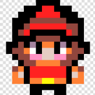
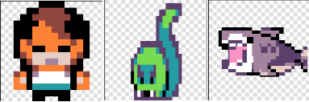
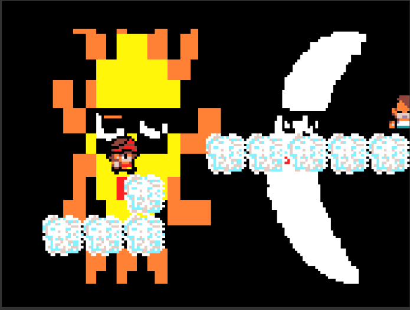
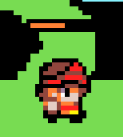

# 🎮 123123

> 🚀 **Click the link below to play my game directly in your web browser!**  
> Direct Link: [https://arcade.makecode.com/S26547-42850-88562-94498](https://arcade.makecode.com/S26547-42850-88562-94498)

A 2D side-scrolling platformer game built with **Microsoft MakeCode Arcade**! 🕹️✨  
Created by a 2nd-grade elementary school developer, this project features hand-drawn pixel art, multi-stage progression, custom enemy AI, screen-transition functions, and loop-based game mechanics.

## 🖼️ Gameplay Screenshot

---

## 🎨 Game Assets & Pixel Art

Every sprite and tile in this game was custom-drawn pixel by pixel in the MakeCode Arcade Sprite Editor:

| Asset | Name | Role & Description |
| :---: | :---: | :--- |
|  | **Red-Hat Hero** | **Player Character:** A brave adventurer wearing a red hat and outfit. Controlled by the player to run and jump across platforms. |
|  | **Monster** | **AI Enemy:** A round pink monster with red feet (inspired by Kirby) programmed with autonomous movement to challenge the player. |
|  | **Sky-Blue Cloud** | **Background Art:** Hand-drawn fluffy clouds outlined in bright sky-blue floating against a dark night sky. |
|  | **Eye-Blinking Effect** | **Custom Animation:** Added frame-by-frame eye-blinking animation to bring the characters to life with natural expressions! (with blink guage as orange bar) |

---

## 🧠 Key Programming Features & Game Logic

This game goes beyond basic movement by using structured coding concepts:

### 1. Stage Progression & Screen Transitions (Functions)
* **Dynamic Level Switching:** Built custom **functions** to handle stage transitions whenever the player reaches the end of a level or triggers a screen change.
* **Scene Setup on Screen Change:** When the screen updates to a new stage, dedicated functions automatically load the new tilemap, reset the hero's starting coordinates, and clear or respawn objects for the next challenge.

### 2. Monster Intelligence (Enemy AI)
* **Smart Movement:** Programmed the pink monster with autonomous behavior so it actively patrols platforms, tracks or reacts to the player's position, and creates dynamic obstacles during gameplay.

### 3. Efficient Game Mechanics with `for` Loops
* **Iterative Spawning & Map Logic:** Used **`for` loops** to repeat tasks cleanly without duplicating code—such as spawning multiple monsters/items across the map, scanning specific tiles in the tilemap, or running repeated animations and effects during screen transitions.

---

## 🕹️ Controls (Keyboard)

| Key | Action |
| :--- | :--- |
| **⬅️ / ➡️ (Arrow Keys)** | Move the hero left and right |
| **Spacebar (or Z / A)** | Jump across gaps and climb platforms |

---

## 💻 Development Environment
* **Engine:** [Microsoft MakeCode Arcade](https://makecode.com)
* **Core Concepts Used:** Custom Functions, `for` Loops, Enemy AI Logic, Tilemap Collisions, Gravity & Velocity Physics
* **Developer:** 2nd Grade Elementary School Student 👦👧

---
> 💡 **GitHub Upload Checklist:** 
> Make sure to upload `gameplay.png`, `hero.png`, `monster.png`, `cloud.png`, and `ground.png` into your repository folder so all images appear properly in the table!
